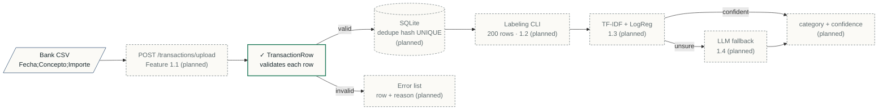

# IHB-01 · Finance Categorizer

Categorizes bank transactions with a fast ML classifier and an LLM fallback for low-confidence cases.

| Headline metric | Dataset | Model | Status |
| --- | --- | --- | --- |
| Evaluation pending | TBD | TBD | Feature 1.1 in progress |

> Part of the **IHB lab series**: six AI engineering projects by Irene (IHB-01 Finance Categorizer, IHB-02 Biotech RAG Assistant, IHB-03 Process Anomaly Detection, IHB-04 Operations SQL Agent, IHB-05 LoRA Extraction Model, IHB-06 Microscopy Cell Classifier).

## How it works

A bank CSV goes in, every row is validated, and each stored transaction gets a category from a fast ML model, with an LLM only for the cases the model is unsure about.

Solid green border = built and tested. Dashed = planned. Diagram conventions live in [docs/STYLE.md](docs/STYLE.md).

## Engineering decisions
Every technical choice, with the options I rejected and why: [docs/DECISIONS.md](docs/DECISIONS.md).

## Learning log
What I built each session and what I learned: [docs/LEARNING_LOG.md](docs/LEARNING_LOG.md).

## License
[MIT](LICENSE)
