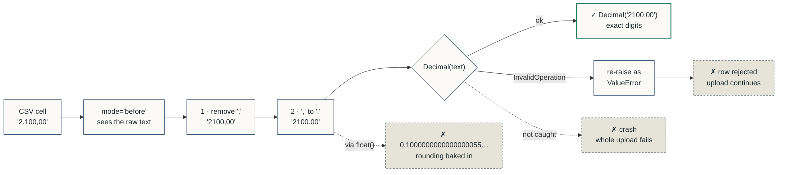

# Learning log

One entry per session: steps taken, concepts learned, problems hit and how I solved them.

## Session 0 (2026-10-18) - Portfolio setup
**Steps taken:**
1. Created the six IHB repos on GitHub (public) through the REST API.
2. Added a starter skeleton to each: README stub with a results row, MIT license, Python .gitignore, decision and learning logs.
**Concepts learned:** Architecture Decision Records (ADRs) as an industry practice; why public repos get unlimited free GitHub Actions minutes.
**Problems + fixes:** No `gh` CLI on Windows -> used the Git Credential Manager token with `curl --ssl-no-revoke` to call the GitHub API.
**Decisions made:** D-001.
**Next session starts with:** Kickoff of the first feature, plus locating the Lab Notebook kit for banners and README_TEMPLATE.md.

## Session 1 (2026-10-18) - Project setup, session 1 of 1
**Steps taken:**
1. Hardened `.gitignore` so all of `data/` and any SQLite file stay out of the public repo.
2. Installed uv and initialized a `src/` package (`finance_api`) with folders for api, ingest, db, categorize and evaluation.
3. Added runtime deps (fastapi, uvicorn, python-multipart) and dev deps (pytest, httpx2, ruff); exported a pinned `requirements.txt`.
4. Added a `/health` endpoint and a smoke test (passing); ruff lint + format clean.
**Concepts learned:** Lockfile vs `requirements.txt` (direct vs transitive pins); why `src/` layout makes tests run against the installed package; liveness checks shouldn't depend on downstream services.
**Problems + fixes:** uv failed with `invalid peer certificate: UnknownIssuer` -> `--system-certs` makes uv use the Windows certificate store. Starlette 1.8 warned that `httpx` is deprecated for TestClient -> replaced with `httpx2`.
**Decisions made:** D-002, D-003, D-004.
**Next session starts with:** Feature 1.1 (CSV upload), with decisions on ORM vs raw SQL, duplicate detection, and pandas vs csv module. Bring one real bank export to check encoding, thousands separator and whether there's a Saldo column.

## Session 2 (2026-10-18) - Feature 1.1, session 1 of 4
**Steps taken:**
1. Chose the database layer, duplicate strategy and CSV parser (D-005 to D-007), and extended D-006 so exports with or without a Saldo column both work.
2. Added SQLAlchemy and re-pinned `requirements.txt`; wrote synthetic fixtures with and without Saldo.
3. Wrote 12 acceptance tests for the row model first, then the `TransactionRow` Pydantic model. The model was generated by Claude at my request instead of written by me.
4. Checked both fixtures through `csv.DictReader`: 7 valid rows and 1 rejected (`31/02/2026`) in each.
5. Added mutation tests (`tests/test_mutants.py`): one deliberate bug per row test, built by patching schemas.py at test time. All 12 mutants are caught, each on the intended assertion; a comment-only control mutant survives, proving the harness reports missed bugs.
**Concepts learned:** Why `Decimal` instead of `float` for money; Pydantic `mode="before"` validators see the raw cell; field aliases map Spanish headers to English fields; one shared parser keeps two fields from drifting apart. Mutation testing checks the tests themselves: a test that passes against broken code gives false confidence.

How one amount cell flows through `TransactionRow`:

Swapping steps 1 and 2 turns `'2.100,00'` into `'2.100.00'`, and the two dots can't be told apart. Mutation testing proves each test would catch that kind of bug (see `tests/test_mutants.py`).

**Problems + fixes:** `mutmut` doesn't run natively on Windows -> hand-written mutants applied as text patches, so they can't drift from the real file. Ruff sorted `finance_api` as third-party -> declared it in `known-first-party`. Field named `date` would shadow the `date` type -> imported `datetime as dt`.
**Decisions made:** D-005, D-006 (with Saldo follow-up), D-007. Blank Saldo cells become `None`, not an error.
**Next session starts with:** the CSV parser for the upload (encoding, row numbering, stripping Pydantic's "Value error, " prefix), written by me.
